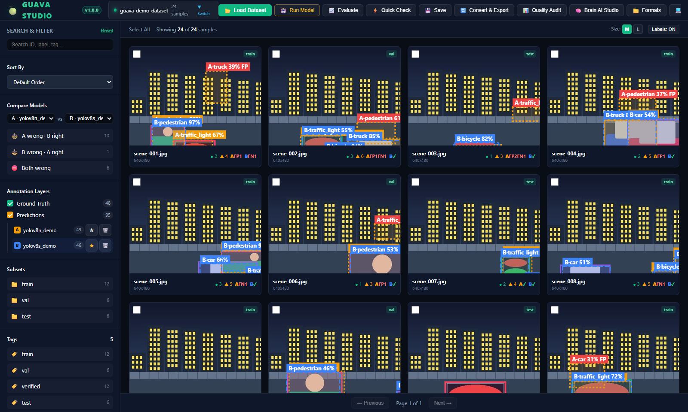
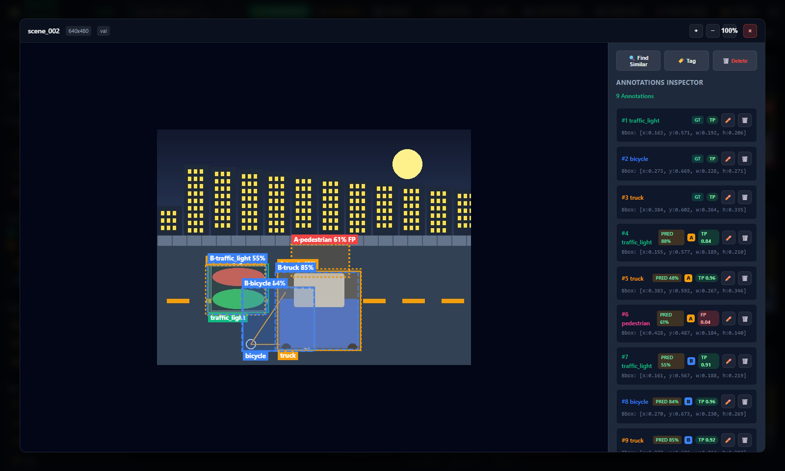
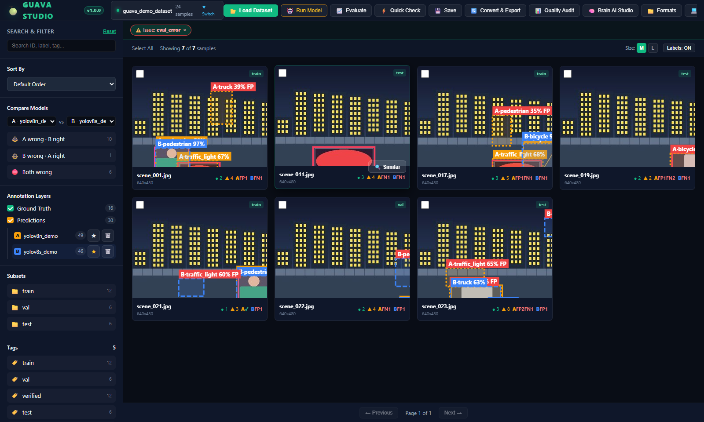
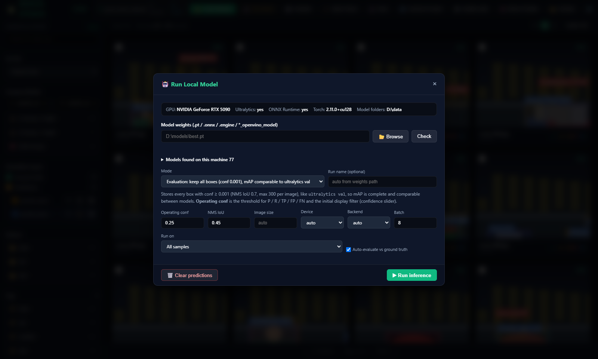
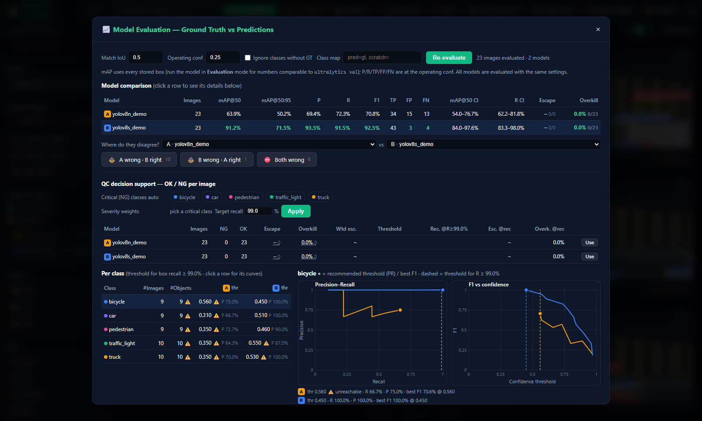
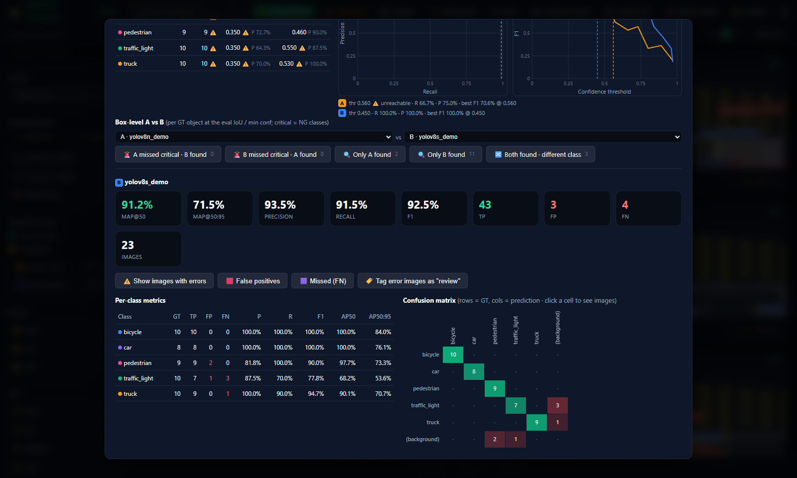
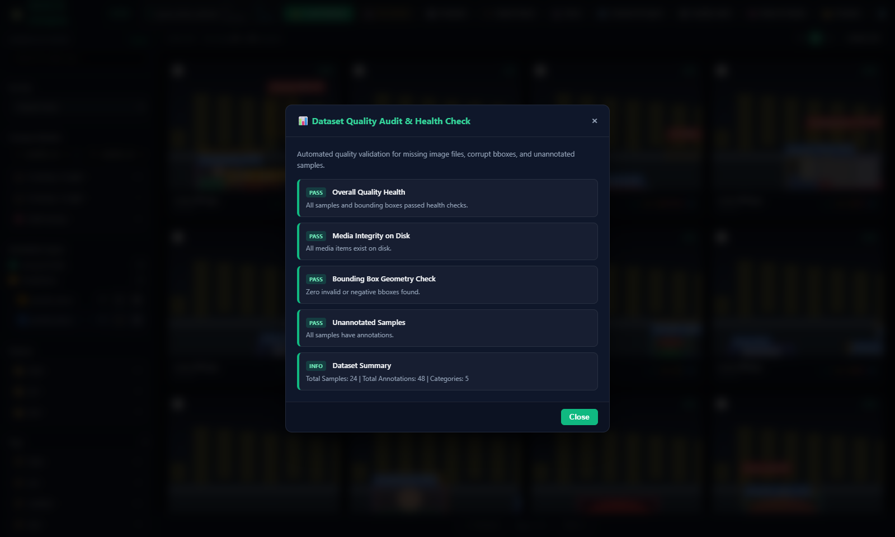
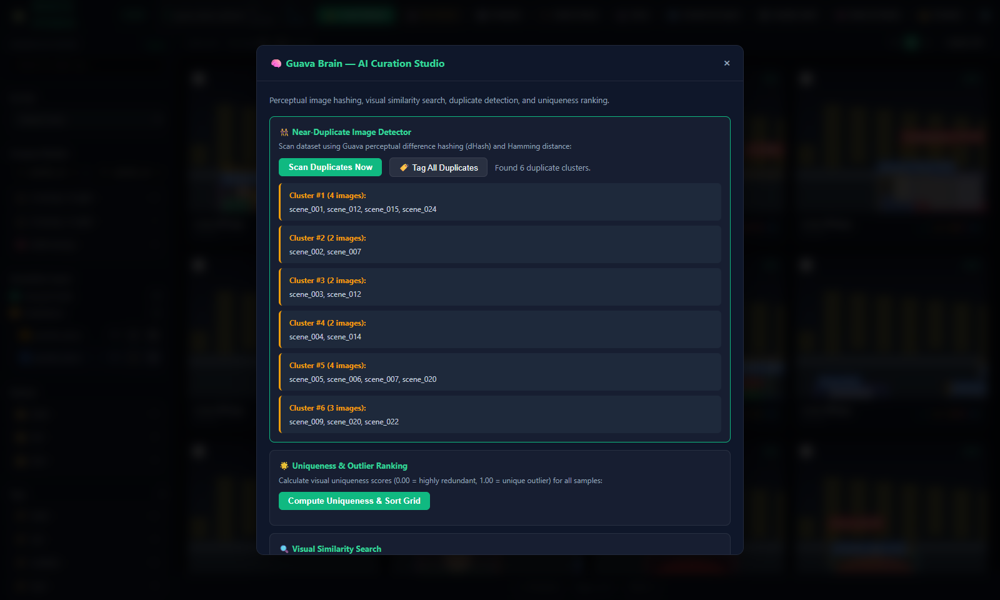
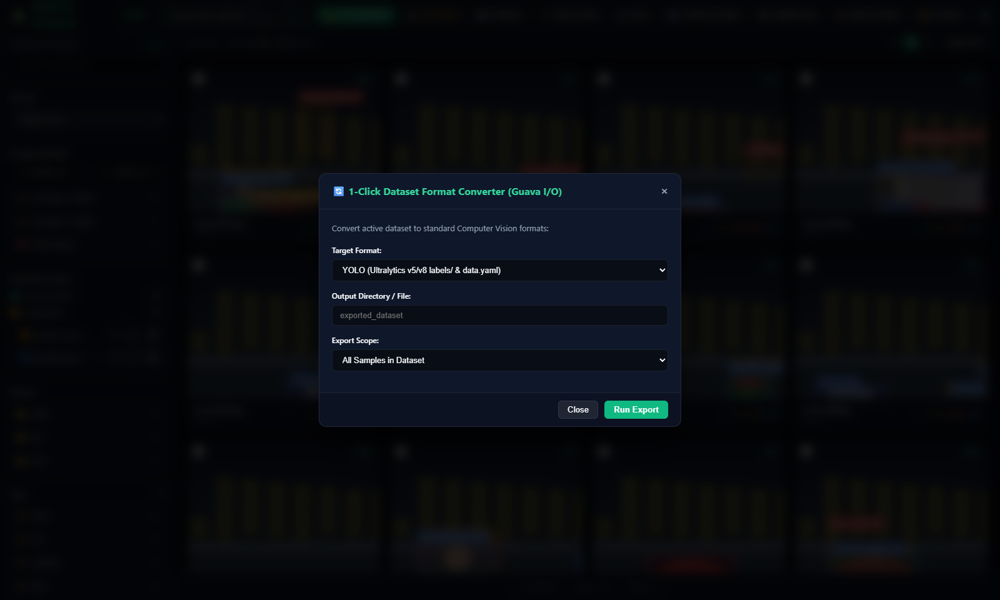

# 🍈 Guava — Unified Dataset Management & AI Visual Studio

**Guava** is an independent, high-performance Computer Vision dataset management and visual analytics platform. It was architected from the ground up to synthesize the best conceptual capabilities in Computer Vision dataset engineering into a unified, lightweight Python engine:

- 🔄 **Universal Dataset Operations & Converters**: Native 1-line bidirectional conversions between **COCO**, **YOLO**, **Pascal VOC**, and **ImageFolder** without heavy external binaries.
- 🎯 **Sample-First Data Model**: Rich `Sample` model supporting Ground Truth vs. Model Predictions, Bounding Boxes, Polygons, Keypoints, Tags, and Custom Metadata.
- 📊 **Quality Validation & Health Audit**: Automatic detection of degenerate bboxes ($w \le 0, h \le 0$), out-of-bounds annotations, missing image files on disk, and class imbalance.
- 🧠 **Guava Brain AI Curation**: Zero-dependency perceptual image hashing (dHash/aHash), near-duplicate detection, and visual uniqueness scoring.
- 🌐 **Guava Studio Visual Web App**: 100% native ASGI web application with a dark-mode interactive UI, HTML5 Canvas annotation overlays, zoom/pan lightbox inspector, multi-facet filtering, and 1-click export modals.



> All screenshots use the built-in synthetic demo dataset (24 generated street scenes, 5 classes) with predictions from two demo models, `yolov8n_demo` (A) and `yolov8s_demo` (B). See the [UI tour](#-ui-tour) below.

---

## 🚀 Quick Start

### 1. Installation

```bash
# Clone the repository
git clone https://github.com/hoanghuy05122003/guava
cd guava

# Install in editable mode
pip install -e .
```

### 2. Python SDK

```python
import guava as gv
from guava.core.annotation import BboxAnnotation
from guava.core.sample import Sample, ImageMetadata

# 1. Load any dataset
dataset = gv.load("coco", "path/to/annotations.json")
# Or create natively:
# dataset = gv.Dataset(name="my_dataset")

# 2. Inspect stats and run quality audit
stats = dataset.stats()
print(f"Total samples: {stats['sample_count']}, annotations: {stats['annotation_count']}")

audit = dataset.audit()
print(f"Dataset clean status: {audit['is_clean']}")

# 3. Filter and split
filtered = dataset.filter(lambda s: len(s.annotations) > 0)
splits = gv.split_dataset(dataset, splits={"train": 0.8, "val": 0.1, "test": 0.1})

# 4. Bidirectional format conversion (COCO -> YOLO, VOC, etc.)
gv.export(dataset, format="yolo", output_dir="output/yolo_dataset")
gv.export(dataset, format="voc", output_dir="output/voc_dataset")

# 5. AI Curation via Guava Brain
duplicates = gv.brain.find_near_duplicates(dataset, threshold=5)
uniqueness = gv.brain.compute_uniqueness(dataset)

# 6. Launch Guava Studio Visual Web App
session = gv.launch_app(dataset, port=5151)
session.wait()
```

---

## 🌐 Guava Studio Visual Web App

Launch the interactive studio from terminal:

```bash
# Launch with built-in interactive demo dataset
python examples/launch_app.py

# Or launch directly with any dataset on disk
python examples/launch_app.py --format coco --path D:/datasets/coco/annotations.json
python examples/launch_app.py --format yolo --path D:/datasets/yolo/
```

### Studio Features:
- 🖼️ **Responsive Thumbnail Grid**: Dynamic card grid with customizable sizes.
- 🎨 **HTML5 Canvas Overlays**: Bounding boxes rendered in real-time with per-category neon color swatches, labels, and confidence tags.
- 🔍 **Lightbox Inspector**: High-resolution zoom & pan, coordinate inspector, tag editor, and metadata breakdown.
- ⚡ **Multi-Facet Filtering**: Real-time category checklist, subset selectors (`train`, `val`, `test`), confidence threshold slider, and ID/tag search.
- 🔄 **1-Click Exporter Modal**: Live export to COCO, YOLO, Pascal VOC, or ImageFolder with real-time feedback.
- 📊 **Quality Health Check Modal**: Instant pass/fail audit for missing media and invalid bounding boxes.
- 🧠 **Brain AI Curation Modal**: Live scan for near-duplicate image clusters.

---

## 🖼️ UI Tour

### Layout

| Area | What it holds |
|---|---|
| **Top bar** | Dataset pill (name + sample count, click to switch dataset) and the main actions: 📂 Load Dataset · 🤖 Run Model · 📈 Evaluate · ⚡ Quick Check · 💾 Save · 🔄 Convert & Export · 📊 Quality Audit · 🧠 Brain AI Studio · 📁 Formats · 💻 SDK |
| **Left sidebar** | Search (ID, label, tag), **Sort By**, **Model Results** / **Compare Models** filters (appear once predictions exist), **Annotation Layers**, **Subsets**, **Tags**, **Categories**, **Min Confidence** slider |
| **Toolbar** | Select All, "Showing X of Y samples", thumbnail size **M / L**, **Labels ON/OFF** |
| **Grid** | One card per image, paginated. Floating action bar appears when cards are selected: 🏷️ Add Tag · 🗑️ Delete · 🔄 Export Selected |

### 1. Sample grid


- Every card draws the image on a canvas with its boxes: **ground truth solid**, **predictions dashed**, each prediction prefixed with its model letter (`A-…`, `B-…`) and confidence. Boxes that don't match ground truth get a red **FP** label.
- The card footer shows the file name, size and a compact score line: `• GT count ▲ prediction count`, then per model `AFP1 FN1` / `B✓` (✓ = every object found, no false alarms).
- The badge in the top-right corner is the subset (`train` / `val` / `test`); the checkbox in the top-left selects the card for batch actions.

**Sidebar details**

- **Sort By**: default order, most/least annotations, lowest/highest confidence, uniqueness (outliers / most redundant), ID, and model-driven sorts: most errors (FP+FN), most FP, most FN, most predictions, least confident prediction, slowest inference.
- **Compare Models**: choose model A and B, then filter to images where *A wrong · B right*, *B wrong · A right* or *Both wrong*. The counts are shown next to each filter.
- **Annotation Layers**: toggle Ground Truth and Predictions. Each model run has its own row with box count, ★ (make it the active model for filters and TP/FP status) and 🗑 (delete its predictions).
- **Subsets / Tags / Categories**: click to filter; counts on the right. Active filters show as removable chips above the grid.

### 2. Lightbox inspector



Click any card to open it full size. **+ / − / 100%** zoom, drag to pan. The right panel, **Annotations Inspector**, lists every box with its source (`GT` or `PRED` + model letter), match status (`TP` / `FP` with IoU), normalized bbox coordinates, and buttons to relabel ✏️ or delete 🗑. Actions on top: **🔍 Find Similar** (reorders the grid by visual similarity to this image), **🏷️ Tag**, **🗑️ Delete**.

### 3. Jump to the mistakes



After evaluation, one click filters the grid to the images a model got wrong (chip `Issue: eval_error`). Here 7 of 24 images remain. Also available: only false positives, only missed objects (FN), a confusion-matrix cell, or a class row. Tick **Draw only FP / FN boxes** in the sidebar to hide correct boxes.

### 4. Run Model



- The header line reports the detected GPU, whether Ultralytics / ONNX Runtime / Torch are installed, and which folders are scanned for weights.
- **Model weights**: type a path, **📂 Browse**, or pick from **Models found on this machine** (`.pt`, `.onnx`, `.engine`, `*_openvino_model`), filterable, with a **Scan** box for extra folders.
- **Mode**: *Evaluation* keeps every box down to conf 0.001 so mAP matches `ultralytics val`; *Display / deploy* keeps only boxes above the operating confidence.
- Parameters: operating conf, NMS IoU, image size, device (auto / GPU / CPU), backend (auto / ultralytics / onnxruntime), batch size, optional run name.
- **Run on**: all samples, current filtered view, selected samples, or only samples without predictions. **Auto-evaluate vs ground truth** runs the evaluation as soon as inference finishes. The job runs in the background with a progress bar and can be cancelled.

### 5. Evaluate & compare models



- Controls: match IoU, operating conf, *Ignore classes without GT*, and a **Class map** (`pred=gt`, comma separated; `scratch=` drops a class) to evaluate models trained with different class names.
- **Model comparison** table: images, mAP@50, mAP@50:95, P, R, F1, TP / FP / FN, bootstrap 95 % confidence intervals for mAP@50 and recall, image-level escape and overkill. Click a row to show that model's details below.
- **Where do they disagree?** A vs B buttons jump to the images where only one of the models is right.
- **QC decision support (OK / NG per image)**: choose which classes are critical (NG), optional severity weights and a target recall. The table shows per model the NG / OK image counts, **escape** (NG image passed), **overkill** (OK image rejected), and the confidence threshold needed to reach the target recall. **Use** applies that threshold.
- **Per class**: the recommended threshold of each model for each class (⚠ = target recall unreachable), plus the **Precision–Recall** and **F1 vs confidence** curves of the selected class for both models.



- **Box-level A vs B**: per ground-truth object, *A missed critical · B found*, *Only A found*, *Only B found*, *Both found · different class*. Each button filters the grid.
- Metric cards for the selected model (mAP@50, mAP@50:95, precision, recall, F1, TP, FP, FN, images).
- Shortcuts: ⚠️ show images with errors, 🟥 false positives, 🟪 missed (FN), 🏷️ tag all error images as `review` (then export them for relabeling).
- **Per-class metrics** table (GT, TP, FP, FN, P, R, F1, AP50, AP50:95) and **confusion matrix** (rows = GT, columns = prediction, plus a `(background)` row/column for FP and FN). Click a cell to see exactly those images.

### 6. Quality Audit



PASS / FAIL cards for overall health, media integrity on disk, bounding-box geometry (invalid, zero or negative size) and unannotated samples, plus a dataset summary. When a check fails, its card gets a button that filters the grid to the affected samples (missing media, degenerate boxes).

### 7. Brain AI Studio



- **Near-Duplicate Image Detector**: dHash + Hamming distance, results grouped in clusters; **🏷️ Tag All Duplicates** marks them for review.
- **Uniqueness & Outlier Ranking**: scores every image from 0 (redundant) to 1 (unique outlier) and sorts the grid.
- **Visual Similarity Search**: from any card or the lightbox via **🔍 Find Similar**.

### 8. Convert & Export



Pick the target format (YOLO, COCO, Pascal VOC, ImageFolder or Guava native JSON), the output folder and the scope (all samples or only the selected ones), then **Run Export**. To export only the images tagged `review` for relabeling, filter by the tag, **Select All**, and export the selection.

### Other actions

- **📂 Load Dataset**: datasets found on disk with a one-click **Load**, quick shortcuts, or a custom path with format auto-detection and a folder browser.
- **⚡ Quick Check**: drag & drop images anywhere in the window (or click the button); they are copied to `~/.guava/quick/` and run through the active model.
- **💾 Save**: writes dataset + predictions + tags + evaluation to a `.guava.json` workspace that can be reopened from Load Dataset.
- **📁 Formats** and **💻 SDK**: reference of the supported formats and copy-paste Python snippets.

---

## 🤖 Offline Model Check (no internet, no MongoDB)

Run your own local weights on a dataset, compare against ground truth and jump straight to the mistakes.

```bash
# Desktop-style window (Edge/Chrome --app mode, or pywebview if installed)
guava studio D:/data/my_yolo_dataset --model D:/models/best.pt

# Headless: predict + metrics in the terminal, optionally open the results
guava predict D:/data/my_yolo_dataset --model D:/models/best.pt --conf 0.25 --save run1 --view
```

```python
import guava as gv
ds = gv.load("yolo", "D:/data/my_yolo_dataset")
model = gv.load_model("D:/models/best.pt")                       # .pt / .onnx / .engine via Ultralytics
# model = gv.load_model("best.onnx", backend="onnxruntime")      # pure ONNX Runtime, no torch
gv.apply_model(ds, model, gv.InferenceConfig(conf=0.25))
report = gv.evaluate(ds, iou=0.5)                                # mAP50, mAP50-95, P/R/F1, confusion matrix
ds.save("run1.guava.json")                                       # reopen later via Load Dataset
```

In the app:
- **🤖 Run Model** — pick weights found on disk (scans `~/.guava/models`, `D:/models`, `D:/data`, plus `GUAVA_MODEL_DIRS`), set conf/IoU/imgsz/device, run on all / filtered / selected images as a background job with progress.
- **📈 Evaluate** — COCO-style metrics per class; click a confusion-matrix cell or a class row to see exactly those images. Boxes are colored TP (green) / FP (red) / FN (rose).
- **⚡ Quick Check** — drag & drop images anywhere in the window; they are copied to `~/.guava/quick/` and run through the current model.
- **💾 Save** — persist dataset + predictions + tags + eval to a `.guava.json` workspace.
- Sidebar **Model Results** filters (errors / FP / FN / no prediction) and sorts (most errors, least confident).

---

## 🖥️ Guava CLI

```bash
# Launch visual studio
guava view /path/to/dataset --format coco

# Print dataset statistics
guava stats /path/to/dataset

# Run health audit
guava audit /path/to/dataset

# Convert between formats
guava convert /input/coco.json /output/yolo/ --from-format coco --to-format yolo
```

---

## 🧪 Testing

Run the full native test suite:

```bash
python -m pytest tests/unit/
```

All 22 unit tests pass in sub-second time.
